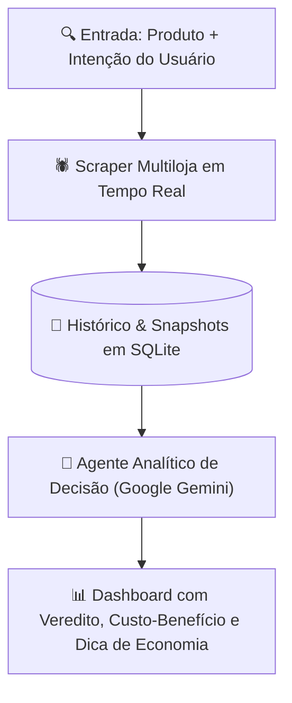

# 🏷️ Preço Certo AI — Monitor & Decision Engine de Compras

<p align="center">
  
  
  
  
  
</p>

Aplicação inteligente que combina **monitoramento contínuo de preços no e-commerce** com um **agente de recomendação e decisão de compra movido por IA**.

Em vez de apenas listar preços como comparadores tradicionais, o **Preço Certo AI** entende o que você precisa ("*melhor custo-benefício até R$ 800*", "*foco em durabilidade para trabalhar*", etc.), cruza reputação de vendedores, frete e histórico de valores, e entrega um **veredito direto**: *Comprar Agora*, *Esperar Promoção* ou *Opção Campeã*.

---

## 💡 O Problema de Negócio

Consumidores perdem horas abrindo 15 abas em múltiplos sites de compras tentando descobrir:
1. Qual produto realmente vale a pena entre dezenas de variações parecidas.
2. Se o "desconto" anunciado é real ou "metade do dobro".
3. Qual oferta equilibra preço baixo, frete grátis e confiabilidade do vendedor.

---

## ⚡ Como Funciona a Solução



---

## 🚀 Funcionalidades Principais

* **Scraper & Indexador de Ofertas:** Coleta dinâmica de preços, descontos, notas e frete grátis dos maiores marketplaces.
* **Agente de Veredito com IA:** Analisa o trade-off de cada oferta e aponta a campeã em custo-benefício com justificativas objetivas.
* **Dicas de Economia Acionáveis:** Recomendações de timing de compra, pagamento no PIX e alertas de preço-alvo.
* **Persistência Completa:** Banco de dados SQLite integrado para acompanhar a variação dos preços ao longo do tempo.
* **Interface Moderna e Responsiva:** Dashboard web desenvolvido com Tailwind CSS e dark-mode nativo.

---

## 🛠️ Stack Tecnológica

* **Linguagem & Backend:** Python 3.11+ (Módulo HTTP nativo sem dependências inchadas).
* **Camada de Inteligência:** Google Gemini 2.5 Flash (`google-genai`) com fallback analítico local baseado em score ponderado.
* **Banco de Dados:** SQLite3 transacional embutido.
* **Frontend:** HTML5 semântico, JavaScript ES6 e Tailwind CSS via CDN.

---

## 📂 Estrutura do Repositório

```
preco-certo/
├── core/
│   ├── database.py       # Criação de tabelas, snapshots de preço e histórico
│   ├── scraper.py        # Coletor de dados resiliente e extrator de ofertas
│   └── advisor.py        # Agente analítico de decisão e chamada Gemini
├── web/
│   ├── templates/
│   │   └── index.html    # Dashboard responsivo com tema escuro
│   └── app.py            # Servidor HTTP e API REST de busca e produtos
├── test_pipeline.py      # Teste automatizado de ponta a ponta
└── README.md             # Documentação completa
```

---

## 🏃 Como Executar Localmente

### 1. Clonar o repositório
```bash
git clone https://github.com/CauaRibeiroXY/preco-certo.git
cd preco-certo
```

### 2. (Opcional) Configurar Chave Gemini
Defina sua chave de API para habilitar as recomendações avançadas da IA:
```bash
# Windows PowerShell
$env:GEMINI_API_KEY="sua_chave_aqui"

# Linux / Mac
export GEMINI_API_KEY="sua_chave_aqui"
```
*(Nota: Caso não informe a chave, o sistema opera automaticamente com o motor heurístico local integrado).*

### 3. Iniciar a Aplicação
```bash
python web/app.py
```
Acesse no seu navegador: **`http://localhost:5050`**

---

## 👨‍💻 Autor

Desenvolvido por **[Cauã Ribeiro](https://github.com/CauaRibeiroXY)**  
*Acadêmico de Ciência da Computação (IFNMG) • AI Builder & Engenheiro de Software*
